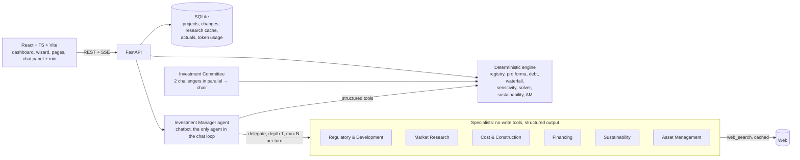

# TerraMind AI — Architecture

TerraMind AI is a real estate investment platform that follows the steps a development fund takes to evaluate a project:
**site → zoning capacity → design → market → budget → capital stack → model → IC → asset management.**
AI agents research and suggest assumptions, the user approves them, and a deterministic Python engine calculates every financial number.

## 1. Design principles

1. **The language model never does financial arithmetic.** Every metric (TDC, GDV, IRR, MOIC, NPV, DSCR, peak equity) comes from `backend/engine/`, which is plain Python with unit tests.
2. **Users enter fundamentals, not outputs.** Land area, regulations, design, prices, absorption, costs per m², and loan terms go in. Areas, unit counts, budget, cash flows, and returns come out.
3. **Every assumption has a provenance.** It is tagged with a source (`user`, `researched`, `default`, or `calculated`) and a status (`approved`, `pending`, or `rejected`). It also carries a confidence level, source URL, date, and its last change. Researched values stay `pending` until the user approves them.
4. **One variable registry drives everything.** Forms, chatbot validation, the Assumption Control Center, and the scenario engine all read `engine/registry.py` (labels, units, ranges, materiality, regulatory flags). Adding a property type means adding registry entries and an engine module, not a new app.
5. **Agents run only when the workflow needs them.** Calculations, what-ifs, and solver questions run as deterministic tools without spawning agents. Research results are cached.

## 2. System diagram

## 3. Agents

| Agent | Kind | Tools | Output |
|---|---|---|---|
| Investment Manager | LLM chat agent | read project, update assumptions (validated), run model, what-if, solve for target, sustainability compare, undo, delegate | Answer plus a summary of changes |
| Regulatory & Development | LLM plus web search | `web_search` | `ZoningFindings` (each value tagged verified / preliminary / not found, with source) |
| Market Research | LLM plus web search | `web_search` | `Comparables` (asking vs. transaction labeled; **price/m² computed by code**) |
| Cost & Construction | LLM plus web search | `web_search` | `CostBenchmarks` (labeled estimate, not a quote) |
| Financing | LLM plus web search | `web_search` | `FinancingBenchmarks` (published / indicative / lender offer) |
| Sustainability | LLM plus web search | `web_search` | Measure parameter estimates (preliminary) |
| Financial Modeling | **Deterministic code** | engine | All metrics. No LLM, by design: cheaper and can't hallucinate |
| Investment Committee | 2 challenger LLM calls → chair LLM call | engine metrics injected | Memo: Invest / Invest with conditions / Reject / Insufficient information |
| Asset Management | Deterministic variances plus LLM commentary | engine | Variance explanation plus actions |

**Loop control (lesson from HW5).** Specialists have no delegation tool, so delegation depth is 1 and circular delegation is impossible. Each chat turn has limits on specialist calls, tool calls, total tokens, and dollars, set in `.env` or the settings page. When a limit is hit, the run stops and asks the user for permission to continue with a higher limit. Identical research requests are served from the cache.

## 4. Database (SQLite)

| Table | Purpose |
|---|---|
| `projects` | id, name, profile (location, type, strategy, model, currency, units, horizon), `assumptions` JSON, `meta` JSON (provenance per variable), status (draft / hypothetical / approved / portfolio), timestamps |
| `changes` | audit trail: project, batch, actor (user / chatbot / agent / system), variable, old → new, reason, undone flag. Used for undo |
| `pending_changes` | material changes waiting for a UI confirmation click (financing, regulatory overrides, IC decisions) |
| `variants` | saved scenarios and alternative configurations (override sets) |
| `research` | latest findings per project and agent (zoning, comps, costs, financing, sustainability) with sources |
| `research_cache` | normalized query hash → result, with TTL. Repeated searches cost 0 tokens |
| `actuals` | monthly actuals per project (cost, units sold, average price, collections, debt balance, progress) |
| `ic_memos` | saved IC memos (recommendation, memo JSON, metrics snapshot) |
| `token_usage` | every model call: run, agent, purpose, input / cached / output tokens, USD |

## 5. Financial engine

**Timeline.** Monthly periods, where t = 0 is land closing. Phases: pre-development (design + permits) → construction → delivery. Sales start at a configurable month and can run during construction (presales).

**Areas.** Footprint = min(design footprint, land × max coverage). Above-ground GBA = footprint × stories, capped at land × max FAR. Saleable area = GBA × efficiency. Units by type = floor(saleable × share / unit size). Parking and below-grade area are driven by parking spaces. Any value above a legal limit marks the scenario **potentially noncompliant**.

**Revenue (build-to-sell).** Unit price = size × base price/m² × (1 + type premium) × (1 + floor/view premium) + terrace m² × terrace factor × price/m², then escalated monthly and reduced by discount. Absorption is net units per month after cancellations. Collections: deposit at contract, construction-stage installments spread to delivery, balance at closing. Commissions are paid at contract. Marketing runs from presale start to sell-out.

**Revenue (build-to-rent / hold).** GPR − vacancy − concessions = EGI. EGI − opex = NOI. Rent growth is applied annually. Terminal value = forward NOI / exit cap, less selling costs. DSCR = NOI / debt service.

**Costs.** Land plus acquisition costs at t = 0. Hard costs per m² (above and below grade) follow an S-curve over construction, split into categories by editable shares, with construction escalation compounding monthly. Soft costs are % of hard (design during pre-development, the rest during construction). Contingency, developer fee, and commercial costs complete the budget.

**Capital stack.** A cash account is funded with equity first, up to the equity requirement, then mezzanine, then senior debt, each up to its commitment (LTC × total cost, solved iteratively because financing cost depends on the debt balance). Interest accrues monthly on the actual balance and is either capitalized or paid. Fees: origination at first draw, commitment fee on undrawn balance. After delivery, a sweep repays senior debt, then mezzanine, then distributes to equity. Any balance at maturity is a balloon; a shortfall is flagged as a **funding gap**. Covenants checked: max LTC, max LTV, presales before first draw, DSCR.

**Metrics.** TDC, total cost with financing, GDV, development profit, gross and net margin, profit on cost, unlevered project IRR, equity IRR, MOIC, NPV (unlevered and equity), peak funding requirement, peak equity, LTC, LTV, DSCR, cash-on-cash, and exit value. Waterfall: return of capital → preferred return (compounded monthly) → promote split, giving investor vs. sponsor IRR and MOIC. IRR is monthly and annualized as (1 + r)^12 − 1. It returns **undefined with a reason** when there is no sign change.

**Analysis.** Scenarios (override sets), tornado (±shock per driver), price × cost heatmap, break-even price, a generic `solve_for` (max land price for a target equity IRR, required price for a target margin), a unit-mix optimizer (enumerates share combinations through the full model), and a sustainability knapsack (budget → best subset, with beneficiary-aware returns).

## 6. Phases

| Phase | Scope | Exit test |
|---|---|---|
| 1 | Engine + registry + tests | `pytest` green, demo case returns sensible metrics |
| 2 | FastAPI + SQLite + seeded demo cases | API returns projects and results |
| 3 | Agents (IM chat tools, specialists, IC, AM) + limits + token ledger | Live chat edits a field; research returns sourced results |
| 4 | Frontend pages + chat panel + mic | Full workflow in the browser |
| 5 | Sustainability, portfolio, asset management | Alerts and variances render |
| 6 | Evidence: live runs, token measurements, safety tests | Numbers recorded in `docs/evidence/` |
| 7 | README, report.html, slides.html, GitHub, fresh-clone dry run | Runs in under 10 minutes from a clean clone |

## 7. Key dependencies and risks

| Risk | Mitigation |
|---|---|
| The staff can't run React + Python within 10 minutes | The built frontend (`frontend/dist`) is committed and served by FastAPI. Staff need only Python: `pip install -r requirements.txt` → `python run.py` |
| `gpt-6-luna` needs the Responses API for tools | Use PydanticAI's `OpenAIResponsesModel` through Portkey (same pattern as Lecture 11) |
| Web search is slow (~45 s) and its results vary | Cache, run specialists only on request, ship captured demo research with sources and dates |
| CDMX zoning data is not reliably on the open web per parcel (SEDUVI's ciudadmx portal is interactive) | The agent reports verified vs. preliminary vs. not found. Manual entry is the default fallback, with a noncompliance flag |
| Deadline (Oct 26, 6 PM) | Priority 1 core first. Advanced features ship as simpler working versions, with limits documented |

## 8. Open-source review

| Repo | License | Status | Decision |
|---|---|---|---|
| oaklandanalytics/pyforma | BSD-3 | last push 2016 | Concept reuse only (parcel → building config → pro forma). Stale, so not a dependency |
| daniel-fink/rangekeeper | MPL-2.0 | active | Concept reuse (flows and spans on a monthly timeline). Heavy deps (pandas, pint, notebooks); not imported |
| NDHoang2003/real-estate-datamap | MIT | active, 2 stars | Idea of a Leaflet parcel map. We use Leaflet + OpenStreetMap directly |
| HyVoid/Real-Estate-Valuation-all-in-one-calculator | Apache-2.0 | active, 1 star | Excel-style pro forma reference for metric definitions; no code reused |
| ladunjexa-pbl/mern-yariga-dashboard | MIT | 2025 | MERN stack, doesn't fit FastAPI. Dashboard layout ideas only |

No code was copied from these repos. Third-party libraries used: FastAPI (MIT), PydanticAI (MIT), OpenAI SDK (Apache-2.0), React (MIT), Vite (MIT), Recharts (MIT), Leaflet / react-leaflet (BSD-2 / Hippocratic-2.1), and lucide-react (ISC).
